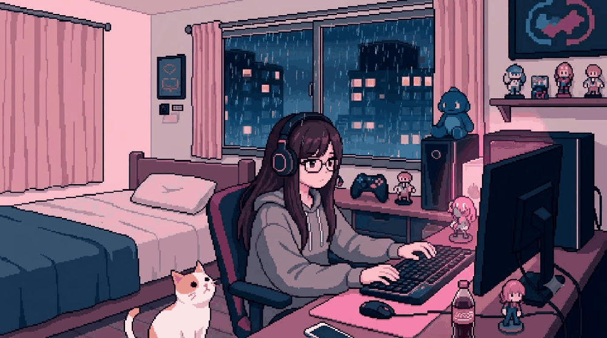
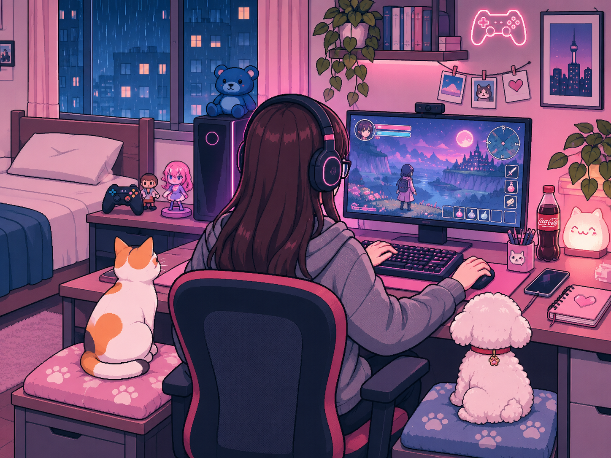
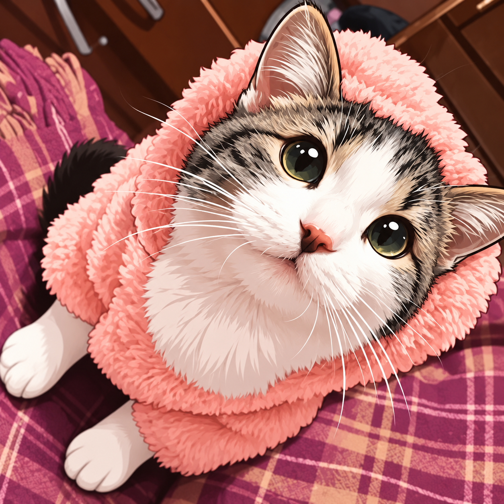

<p align="center">
  
</p>

<p align="center">
  <a href="https://github.com/LuzGabrielaTC">
    
  </a>
</p>

<p align="center">
  
  <a href="https://github.com/LuzGabrielaTC?tab=followers">
    </a>
  
</p>

<p align="center"></p>



<h3>🌸 Sobre mí</h3>

- 🎓 Estudiante de la carrera de **Informática**, <br> aprendiendo algo nuevo cada semana.
- ⚙️ Mi fuerte es el **backend**: APIs y lógica de negocio.
- 🎨 Me obsesiona el **buen diseño**: si no se ve bien, todavía no está terminado.
- 🎬 También edito en **CapCut** y diseño en **Canva** y **Figma**.
- 🤝 Me gusta mucho **trabajar en equipo**.

<h3>💌 Mi contacto</h3>

<a href="https://www.linkedin.com/in/tinta-chura-luz-gabriela-9143a6333?utm_source=share_via&utm_content=profile&utm_medium=member_android" target="_blank"></a>
<a href="https://www.facebook.com/share/19itub7e22/" target="_blank"></a>

<br clear="right" />
<br />

<p align="center"></p>

<h3 align="center">🛠️ Mi stack</h3>

<table align="center">
  <tr>
    <td align="center" width="50%">
      
    </td>
    <td align="center" width="50%">
      
      
    </td>
  </tr>
  <tr>
    <td align="center">
      <br />
      
      
      
    </td>
    <td align="center">
      <br />
      
    </td>
  </tr>
  <tr>
  </tr>
</table>

<br />

<h3 align="center">☕ Yo, en código</h3>

```php
<?php

class Yo extends EstudianteDeInformatica
{
    public string $fuerte     = 'Backend (Laravel · Spring Boot)';
    public array  $frontend   = ['React', 'TypeScript', 'HTML', 'CSS'];
    public array  $peliculas  = ['acción', 'terror', 'romance'];
    public string $mascotaFav = '🐈 gatos, siempre gatos';

    public function filosofia(): string
    {
        return 'Que funcione bien, y que se vea todavía mejor.';
    }

    public function trabajo(): string
    {
        return 'Mejor en equipo 🤝';
    }
}
```

<p align="center"></p>

<h3 align="center">📊 Mi actividad en GitHub</h3>

<p align="center">
  
</p>

<p align="center"></p>

<h3 align="center">🌙 Cuando no estoy programando</h3>

<table align="center">
  <tr>
    <td align="center" width="33%">
      <br />
      <b>🐾 Gatos</b><br />
      <sub>Amante de los animales, me gusta pasar tiempo con la cosita preciosa de la foto de arriba :p</sub>
    </td>
</table>

<br />
<p align="center">
  <sub>Hecho con 💗, mucho ☕ y un gato vigilando el teclado.</sub>
</p>
